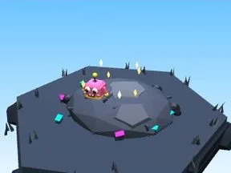

# Tas à ratisser Cyber City

Zone de récolte où apparaissent les brainrots.

- **Catégorie** : [Biomes](../Biomes.md)
- **Sous-catégorie** : [Cyber City](Cyber%20City.md)
- **Type** : Élément de biome
- **Taille** : 8 × 4 × 8 studs
