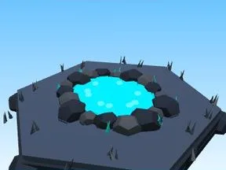

# Étang Cyber City

Étang avec bordure de pierres.

- **Catégorie** : [Biomes](../Biomes.md)
- **Sous-catégorie** : [Cyber City](Cyber%20City.md)
- **Type** : Élément de biome
- **Taille** : 12 × 2 × 11 studs
