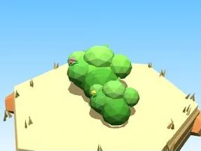

# Buisson Désert

Buisson aux couleurs du biome.

- **Catégorie** : [Biomes](../Biomes.md)
- **Sous-catégorie** : [Désert](D%C3%A9sert.md)
- **Type** : Élément de biome
- **Taille** : 7 × 3 × 5 studs
