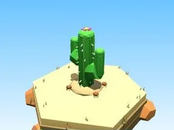
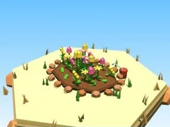
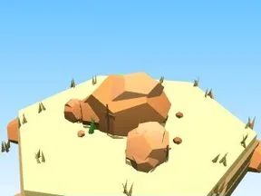
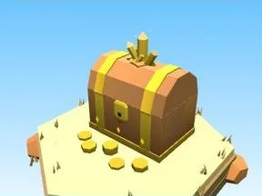
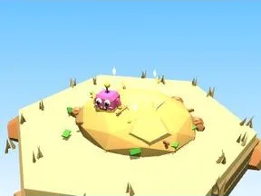
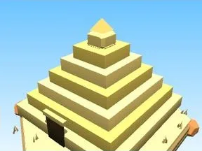

# Désert

Sous-catégorie de [Biomes](../Biomes.md) · **16 éléments**

| Aperçu | Élément | Infos |
| --- | --- | --- |
|  | [Arbre Désert](Arbre%20D%C3%A9sert.md) | Élément de biome · 5 × 7 × 2 |
|  | [Petit arbre Désert](Petit%20arbre%20D%C3%A9sert.md) | Élément de biome · 3 × 4 × 1 |
|  | [Buisson Désert](Buisson%20D%C3%A9sert.md) | Élément de biome · 7 × 3 × 5 |
|  | [Massif de fleurs Désert](Massif%20de%20fleurs%20D%C3%A9sert.md) | Élément de biome · 10 × 4 × 8 |
|  | [Rochers Désert](Rochers%20D%C3%A9sert.md) | Élément de biome · 7 × 4 × 6 |
|  | [Gros rocher Désert](Gros%20rocher%20D%C3%A9sert.md) | Élément de biome · 10 × 8 × 9 |
|  | [Cristaux Désert](Cristaux%20D%C3%A9sert.md) | Élément de biome · 6 × 7 × 6 |
|  | [Bloc de terrain Désert](Bloc%20de%20terrain%20D%C3%A9sert.md) | Élément de biome · 13 × 4 × 12 |
|  | [Étang Désert](%C3%89tang%20D%C3%A9sert.md) | Élément de biome · 12 × 5 × 11 |
|  | [Œuf Désert](%C5%92uf%20D%C3%A9sert.md) | Élément de biome · 5 × 4 × 4 |
|  | [Coffre Désert](Coffre%20D%C3%A9sert.md) | Élément de biome · 5 × 6 × 5 |
|  | [Clôture Désert](Cl%C3%B4ture%20D%C3%A9sert.md) | Élément de biome · 20 × 6 × 2 |
|  | [Portail de zone Désert](Portail%20de%20zone%20D%C3%A9sert.md) | Élément de biome · 18 × 14 × 9 |
|  | [Tas à ratisser Désert](Tas%20%C3%A0%20ratisser%20D%C3%A9sert.md) | Élément de biome · 8 × 4 × 8 |
|  | [Pyramide (Désert)](Pyramide%20%28D%C3%A9sert%29.md) | Modèle low-poly · 18 × 14 × 18 |
|  | [Rocher crâne (Désert)](Rocher%20cr%C3%A2ne%20%28D%C3%A9sert%29.md) | Modèle low-poly · 12 × 8 × 10 |
