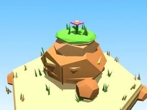

# Gros rocher Désert

Gros bloc rocheux avec végétation.

- **Catégorie** : [Biomes](../Biomes.md)
- **Sous-catégorie** : [Désert](D%C3%A9sert.md)
- **Type** : Élément de biome
- **Taille** : 10 × 8 × 9 studs
