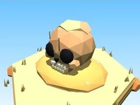

# Rocher crâne (Désert)

Décor spécial du biome Désert.

- **Catégorie** : [Biomes](../Biomes.md)
- **Sous-catégorie** : [Désert](D%C3%A9sert.md)
- **Type** : Modèle low-poly
- **Taille** : 12 × 8 × 10 studs
