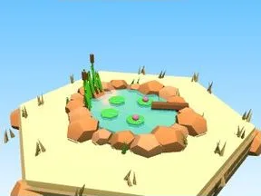

# Étang Désert

Étang avec bordure de pierres.

- **Catégorie** : [Biomes](../Biomes.md)
- **Sous-catégorie** : [Désert](D%C3%A9sert.md)
- **Type** : Élément de biome
- **Taille** : 12 × 5 × 11 studs
