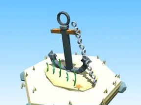

# Ancre (Fond marin)

Décor spécial du biome Fond marin.

- **Catégorie** : [Biomes](../Biomes.md)
- **Sous-catégorie** : [Fond marin](Fond%20marin.md)
- **Type** : Modèle low-poly
- **Taille** : 11 × 12 × 8 studs
