# Fond marin

Sous-catégorie de [Biomes](../Biomes.md) · **16 éléments**

| Aperçu | Élément | Infos |
| --- | --- | --- |
| 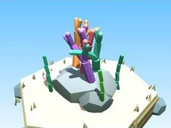 | [Arbre Fond marin](Arbre%20Fond%20marin.md) | Élément de biome · 4 × 6 × 5 |
|  | [Petit arbre Fond marin](Petit%20arbre%20Fond%20marin.md) | Élément de biome · 2 × 4 × 3 |
| 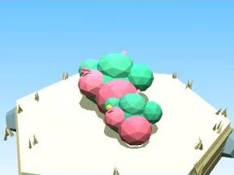 | [Buisson Fond marin](Buisson%20Fond%20marin.md) | Élément de biome · 7 × 3 × 5 |
|  | [Massif de fleurs Fond marin](Massif%20de%20fleurs%20Fond%20marin.md) | Élément de biome · 10 × 4 × 8 |
| 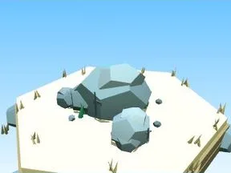 | [Rochers Fond marin](Rochers%20Fond%20marin.md) | Élément de biome · 7 × 4 × 6 |
|  | [Gros rocher Fond marin](Gros%20rocher%20Fond%20marin.md) | Élément de biome · 10 × 8 × 9 |
|  | [Cristaux Fond marin](Cristaux%20Fond%20marin.md) | Élément de biome · 6 × 7 × 6 |
| 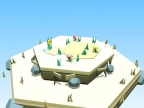 | [Bloc de terrain Fond marin](Bloc%20de%20terrain%20Fond%20marin.md) | Élément de biome · 13 × 4 × 12 |
| 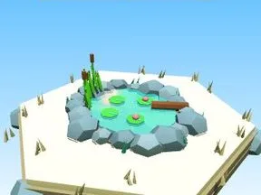 | [Étang Fond marin](%C3%89tang%20Fond%20marin.md) | Élément de biome · 12 × 5 × 11 |
| 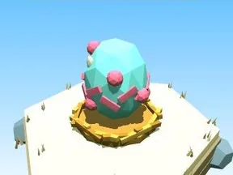 | [Œuf Fond marin](%C5%92uf%20Fond%20marin.md) | Élément de biome · 5 × 4 × 4 |
| 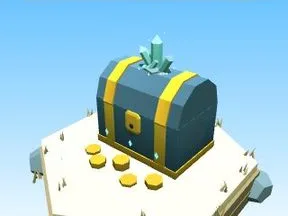 | [Coffre Fond marin](Coffre%20Fond%20marin.md) | Élément de biome · 5 × 6 × 5 |
| 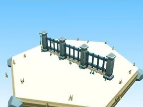 | [Clôture Fond marin](Cl%C3%B4ture%20Fond%20marin.md) | Élément de biome · 20 × 6 × 2 |
| 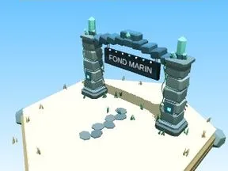 | [Portail de zone Fond marin](Portail%20de%20zone%20Fond%20marin.md) | Élément de biome · 18 × 14 × 9 |
| 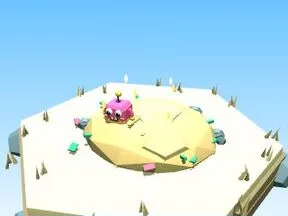 | [Tas à ratisser Fond marin](Tas%20%C3%A0%20ratisser%20Fond%20marin.md) | Élément de biome · 8 × 4 × 8 |
| 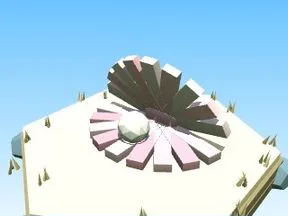 | [Coquillage géant (Fond marin)](Coquillage%20g%C3%A9ant%20%28Fond%20marin%29.md) | Modèle low-poly · 9 × 5 × 6 |
|  | [Ancre (Fond marin)](Ancre%20%28Fond%20marin%29.md) | Modèle low-poly · 11 × 12 × 8 |
