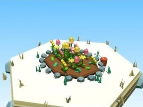

# Massif de fleurs Fond marin

Fleurs du biome.

- **Catégorie** : [Biomes](../Biomes.md)
- **Sous-catégorie** : [Fond marin](Fond%20marin.md)
- **Type** : Élément de biome
- **Taille** : 10 × 4 × 8 studs
