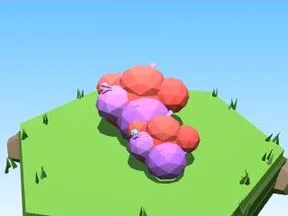

# Buisson Forêt champignon

Buisson aux couleurs du biome.

- **Catégorie** : [Biomes](../Biomes.md)
- **Sous-catégorie** : [Forêt champignon](For%C3%AAt%20champignon.md)
- **Type** : Élément de biome
- **Taille** : 7 × 3 × 5 studs
