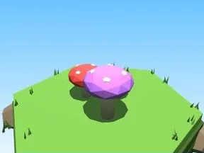

# Champignons (Forêt champignon)

Décor spécial du biome Forêt champignon.

- **Catégorie** : [Biomes](../Biomes.md)
- **Sous-catégorie** : [Forêt champignon](For%C3%AAt%20champignon.md)
- **Type** : Modèle low-poly
- **Taille** : 4 × 2 × 3 studs
