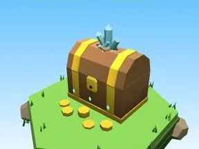

# Coffre Forêt champignon

Coffre à trésor du biome.

- **Catégorie** : [Biomes](../Biomes.md)
- **Sous-catégorie** : [Forêt champignon](For%C3%AAt%20champignon.md)
- **Type** : Élément de biome
- **Taille** : 5 × 6 × 5 studs
