# Forêt champignon

Sous-catégorie de [Biomes](../Biomes.md) · **16 éléments**

| Aperçu | Élément | Infos |
| --- | --- | --- |
| 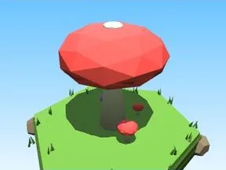 | [Arbre Forêt champignon](Arbre%20For%C3%AAt%20champignon.md) | Élément de biome · 9 × 10 × 9 |
| 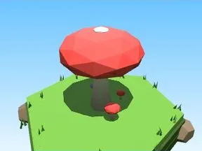 | [Petit arbre Forêt champignon](Petit%20arbre%20For%C3%AAt%20champignon.md) | Élément de biome · 6 × 6 × 6 |
|  | [Buisson Forêt champignon](Buisson%20For%C3%AAt%20champignon.md) | Élément de biome · 7 × 3 × 5 |
| 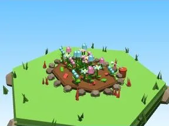 | [Massif de fleurs Forêt champignon](Massif%20de%20fleurs%20For%C3%AAt%20champignon.md) | Élément de biome · 10 × 4 × 8 |
| 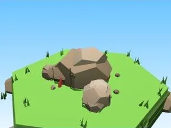 | [Rochers Forêt champignon](Rochers%20For%C3%AAt%20champignon.md) | Élément de biome · 7 × 4 × 6 |
| 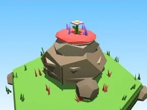 | [Gros rocher Forêt champignon](Gros%20rocher%20For%C3%AAt%20champignon.md) | Élément de biome · 10 × 8 × 9 |
| 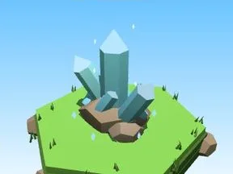 | [Cristaux Forêt champignon](Cristaux%20For%C3%AAt%20champignon.md) | Élément de biome · 6 × 7 × 6 |
| 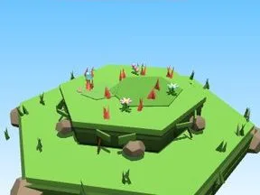 | [Bloc de terrain Forêt champignon](Bloc%20de%20terrain%20For%C3%AAt%20champignon.md) | Élément de biome · 13 × 4 × 12 |
| 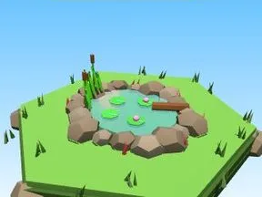 | [Étang Forêt champignon](%C3%89tang%20For%C3%AAt%20champignon.md) | Élément de biome · 12 × 5 × 11 |
| 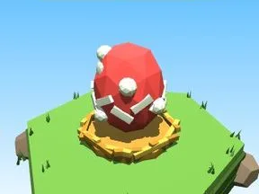 | [Œuf Forêt champignon](%C5%92uf%20For%C3%AAt%20champignon.md) | Élément de biome · 5 × 4 × 4 |
|  | [Coffre Forêt champignon](Coffre%20For%C3%AAt%20champignon.md) | Élément de biome · 5 × 6 × 5 |
| 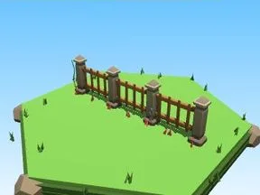 | [Clôture Forêt champignon](Cl%C3%B4ture%20For%C3%AAt%20champignon.md) | Élément de biome · 20 × 6 × 2 |
| 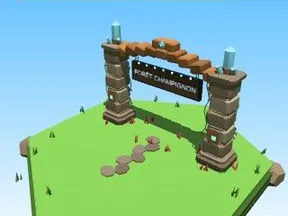 | [Portail de zone Forêt champignon](Portail%20de%20zone%20For%C3%AAt%20champignon.md) | Élément de biome · 18 × 14 × 9 |
| 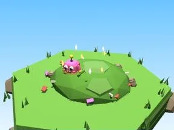 | [Tas à ratisser Forêt champignon](Tas%20%C3%A0%20ratisser%20For%C3%AAt%20champignon.md) | Élément de biome · 8 × 4 × 8 |
|  | [Champignons (Forêt champignon)](Champignons%20%28For%C3%AAt%20champignon%29.md) | Modèle low-poly · 4 × 2 × 3 |
| 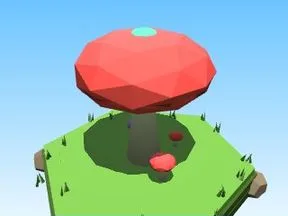 | [Champignon lumineux (Forêt champignon)](Champignon%20lumineux%20%28For%C3%AAt%20champignon%29.md) | Modèle low-poly · 9 × 10 × 9 |
