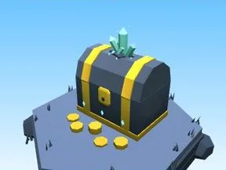

# Coffre Grotte de cristal

Coffre à trésor du biome.

- **Catégorie** : [Biomes](../Biomes.md)
- **Sous-catégorie** : [Grotte de cristal](Grotte%20de%20cristal.md)
- **Type** : Élément de biome
- **Taille** : 5 × 6 × 5 studs
