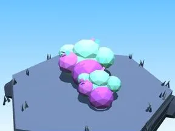
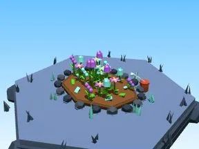
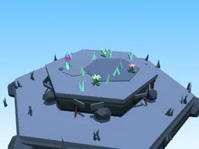
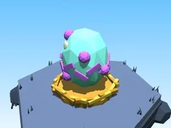
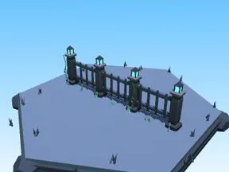
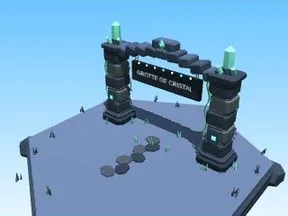
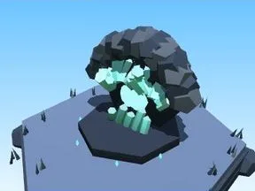

# Grotte de cristal

Sous-catégorie de [Biomes](../Biomes.md) · **16 éléments**

| Aperçu | Élément | Infos |
| --- | --- | --- |
|  | [Arbre Grotte de cristal](Arbre%20Grotte%20de%20cristal.md) | Élément de biome · 6 × 12 × 6 |
|  | [Petit arbre Grotte de cristal](Petit%20arbre%20Grotte%20de%20cristal.md) | Élément de biome · 4 × 7 × 4 |
|  | [Buisson Grotte de cristal](Buisson%20Grotte%20de%20cristal.md) | Élément de biome · 7 × 3 × 5 |
|  | [Massif de fleurs Grotte de cristal](Massif%20de%20fleurs%20Grotte%20de%20cristal.md) | Élément de biome · 10 × 4 × 8 |
|  | [Rochers Grotte de cristal](Rochers%20Grotte%20de%20cristal.md) | Élément de biome · 7 × 4 × 6 |
|  | [Gros rocher Grotte de cristal](Gros%20rocher%20Grotte%20de%20cristal.md) | Élément de biome · 10 × 8 × 9 |
|  | [Cristaux Grotte de cristal](Cristaux%20Grotte%20de%20cristal.md) | Élément de biome · 6 × 7 × 6 |
|  | [Bloc de terrain Grotte de cristal](Bloc%20de%20terrain%20Grotte%20de%20cristal.md) | Élément de biome · 13 × 4 × 12 |
|  | [Étang Grotte de cristal](%C3%89tang%20Grotte%20de%20cristal.md) | Élément de biome · 12 × 2 × 11 |
|  | [Œuf Grotte de cristal](%C5%92uf%20Grotte%20de%20cristal.md) | Élément de biome · 5 × 4 × 4 |
|  | [Coffre Grotte de cristal](Coffre%20Grotte%20de%20cristal.md) | Élément de biome · 5 × 6 × 5 |
|  | [Clôture Grotte de cristal](Cl%C3%B4ture%20Grotte%20de%20cristal.md) | Élément de biome · 20 × 6 × 2 |
|  | [Portail de zone Grotte de cristal](Portail%20de%20zone%20Grotte%20de%20cristal.md) | Élément de biome · 18 × 14 × 9 |
|  | [Tas à ratisser Grotte de cristal](Tas%20%C3%A0%20ratisser%20Grotte%20de%20cristal.md) | Élément de biome · 8 × 4 × 8 |
|  | [Géode (Grotte de cristal)](G%C3%A9ode%20%28Grotte%20de%20cristal%29.md) | Modèle low-poly · 8 × 6 × 7 |
|  | [Pilier de cristal (Grotte de cristal)](Pilier%20de%20cristal%20%28Grotte%20de%20cristal%29.md) | Modèle low-poly · 7 × 14 × 6 |
