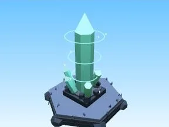

# Pilier de cristal (Grotte de cristal)

Décor spécial du biome Grotte de cristal.

- **Catégorie** : [Biomes](../Biomes.md)
- **Sous-catégorie** : [Grotte de cristal](Grotte%20de%20cristal.md)
- **Type** : Modèle low-poly
- **Taille** : 7 × 14 × 6 studs
