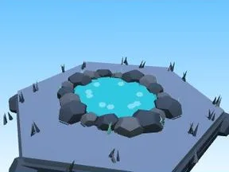

# Étang Grotte de cristal

Étang avec bordure de pierres.

- **Catégorie** : [Biomes](../Biomes.md)
- **Sous-catégorie** : [Grotte de cristal](Grotte%20de%20cristal.md)
- **Type** : Élément de biome
- **Taille** : 12 × 2 × 11 studs
