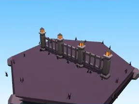

# Clôture Halloween

Clôture aux couleurs du biome.

- **Catégorie** : [Biomes](../Biomes.md)
- **Sous-catégorie** : [Halloween](Halloween%20%28Biomes%29.md)
- **Type** : Élément de biome
- **Taille** : 20 × 6 × 2 studs
