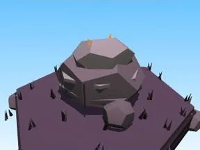

# Gros rocher Halloween

Gros bloc rocheux avec végétation.

- **Catégorie** : [Biomes](../Biomes.md)
- **Sous-catégorie** : [Halloween](Halloween%20%28Biomes%29.md)
- **Type** : Élément de biome
- **Taille** : 10 × 6 × 9 studs
