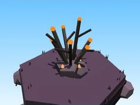
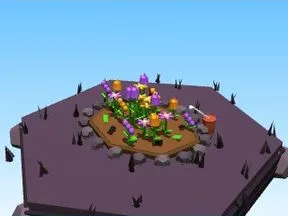
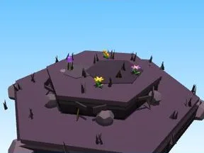

# Halloween

Sous-catégorie de [Biomes](../Biomes.md) · **16 éléments**

| Aperçu | Élément | Infos |
| --- | --- | --- |
|  | [Arbre Halloween](Arbre%20Halloween.md) | Élément de biome · 9 × 10 × 6 |
|  | [Petit arbre Halloween](Petit%20arbre%20Halloween.md) | Élément de biome · 6 × 6 × 3 |
|  | [Buisson Halloween](Buisson%20Halloween.md) | Élément de biome · 4 × 4 × 4 |
|  | [Massif de fleurs Halloween](Massif%20de%20fleurs%20Halloween.md) | Élément de biome · 10 × 4 × 8 |
|  | [Rochers Halloween](Rochers%20Halloween.md) | Élément de biome · 7 × 4 × 6 |
|  | [Gros rocher Halloween](Gros%20rocher%20Halloween.md) | Élément de biome · 10 × 6 × 9 |
|  | [Cristaux Halloween](Cristaux%20Halloween.md) | Élément de biome · 6 × 7 × 6 |
|  | [Bloc de terrain Halloween](Bloc%20de%20terrain%20Halloween.md) | Élément de biome · 13 × 4 × 12 |
|  | [Étang Halloween](%C3%89tang%20Halloween.md) | Élément de biome · 12 × 2 × 11 |
|  | [Œuf Halloween](%C5%92uf%20Halloween.md) | Élément de biome · 5 × 4 × 4 |
|  | [Coffre Halloween](Coffre%20Halloween.md) | Élément de biome · 5 × 6 × 5 |
|  | [Clôture Halloween](Cl%C3%B4ture%20Halloween.md) | Élément de biome · 20 × 6 × 2 |
|  | [Portail de zone Halloween](Portail%20de%20zone%20Halloween.md) | Élément de biome · 18 × 14 × 9 |
|  | [Tas à ratisser Halloween](Tas%20%C3%A0%20ratisser%20Halloween.md) | Élément de biome · 8 × 4 × 8 |
|  | [Citrouilles (Halloween)](Citrouilles%20%28Halloween%29.md) | Modèle low-poly · 7 × 3 × 4 |
|  | [Pierre tombale (Halloween)](Pierre%20tombale%20%28Halloween%29.md) | Modèle low-poly · 9 × 7 × 8 |
