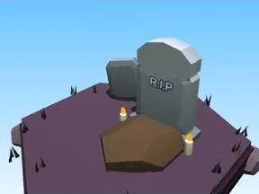

# Pierre tombale (Halloween)

Décor spécial du biome Halloween.

- **Catégorie** : [Biomes](../Biomes.md)
- **Sous-catégorie** : [Halloween](Halloween%20%28Biomes%29.md)
- **Type** : Modèle low-poly
- **Taille** : 9 × 7 × 8 studs
