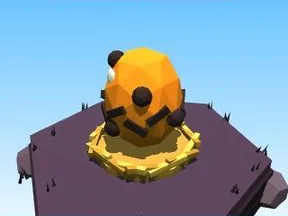

# Œuf Halloween

Œuf du biome sur son nid.

- **Catégorie** : [Biomes](../Biomes.md)
- **Sous-catégorie** : [Halloween](Halloween%20%28Biomes%29.md)
- **Type** : Élément de biome
- **Taille** : 5 × 4 × 4 studs
