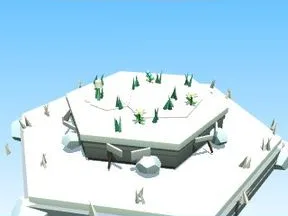

# Bloc de terrain Ice

Morceau de sol hexagonal décoré, pour composer la map.

- **Catégorie** : [Biomes](../Biomes.md)
- **Sous-catégorie** : [Ice](Ice.md)
- **Type** : Élément de biome
- **Taille** : 13 × 4 × 12 studs
