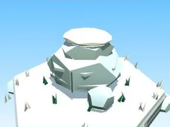
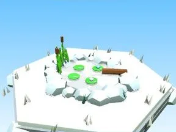
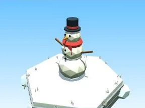

# Ice

Sous-catégorie de [Biomes](../Biomes.md) · **16 éléments**

| Aperçu | Élément | Infos |
| --- | --- | --- |
|  | [Arbre Ice](Arbre%20Ice.md) | Élément de biome · 7 × 12 × 7 |
|  | [Petit arbre Ice](Petit%20arbre%20Ice.md) | Élément de biome · 4 × 7 × 4 |
|  | [Buisson Ice](Buisson%20Ice.md) | Élément de biome · 7 × 3 × 5 |
|  | [Massif de fleurs Ice](Massif%20de%20fleurs%20Ice.md) | Élément de biome · 10 × 4 × 8 |
|  | [Rochers Ice](Rochers%20Ice.md) | Élément de biome · 7 × 4 × 6 |
|  | [Gros rocher Ice](Gros%20rocher%20Ice.md) | Élément de biome · 10 × 6 × 9 |
|  | [Cristaux Ice](Cristaux%20Ice.md) | Élément de biome · 6 × 7 × 6 |
|  | [Bloc de terrain Ice](Bloc%20de%20terrain%20Ice.md) | Élément de biome · 13 × 4 × 12 |
|  | [Étang Ice](%C3%89tang%20Ice.md) | Élément de biome · 12 × 5 × 11 |
|  | [Œuf Ice](%C5%92uf%20Ice.md) | Élément de biome · 5 × 4 × 4 |
|  | [Coffre Ice](Coffre%20Ice.md) | Élément de biome · 7 × 8 × 5 |
|  | [Clôture Ice](Cl%C3%B4ture%20Ice.md) | Élément de biome · 20 × 6 × 2 |
|  | [Portail de zone Ice](Portail%20de%20zone%20Ice.md) | Élément de biome · 18 × 14 × 9 |
|  | [Tas à ratisser Ice](Tas%20%C3%A0%20ratisser%20Ice.md) | Élément de biome · 8 × 4 × 8 |
|  | [Bonhomme de neige (Ice)](Bonhomme%20de%20neige%20%28Ice%29.md) | Modèle low-poly · 5 × 6 × 3 |
|  | [Igloo (Ice)](Igloo%20%28Ice%29.md) | Modèle low-poly · 13 × 8 × 13 |
