# Jungle

Sous-catégorie de [Biomes](../Biomes.md) · **16 éléments**

| Aperçu | Élément | Infos |
| --- | --- | --- |
| 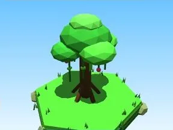 | [Arbre Jungle](Arbre%20Jungle.md) | Élément de biome · 10 × 13 × 10 |
| 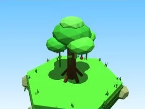 | [Petit arbre Jungle](Petit%20arbre%20Jungle.md) | Élément de biome · 6 × 8 × 6 |
| 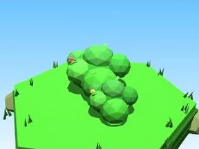 | [Buisson Jungle](Buisson%20Jungle.md) | Élément de biome · 7 × 3 × 5 |
| 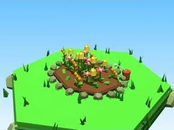 | [Massif de fleurs Jungle](Massif%20de%20fleurs%20Jungle.md) | Élément de biome · 10 × 4 × 8 |
| 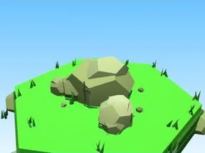 | [Rochers Jungle](Rochers%20Jungle.md) | Élément de biome · 7 × 4 × 6 |
| 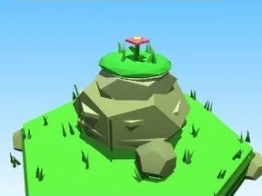 | [Gros rocher Jungle](Gros%20rocher%20Jungle.md) | Élément de biome · 10 × 8 × 9 |
| 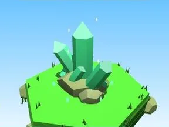 | [Cristaux Jungle](Cristaux%20Jungle.md) | Élément de biome · 6 × 7 × 6 |
| 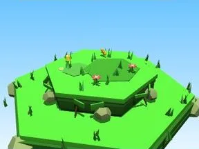 | [Bloc de terrain Jungle](Bloc%20de%20terrain%20Jungle.md) | Élément de biome · 13 × 4 × 12 |
| 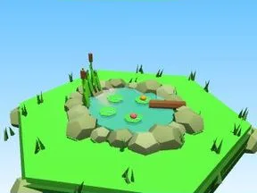 | [Étang Jungle](%C3%89tang%20Jungle.md) | Élément de biome · 12 × 5 × 11 |
| 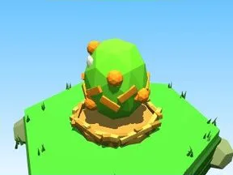 | [Œuf Jungle](%C5%92uf%20Jungle.md) | Élément de biome · 5 × 4 × 4 |
| 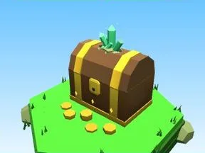 | [Coffre Jungle](Coffre%20Jungle.md) | Élément de biome · 5 × 6 × 5 |
| 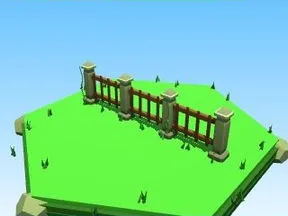 | [Clôture Jungle](Cl%C3%B4ture%20Jungle.md) | Élément de biome · 20 × 6 × 2 |
| 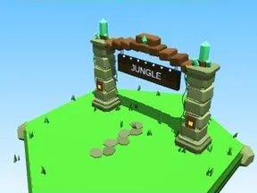 | [Portail de zone Jungle](Portail%20de%20zone%20Jungle.md) | Élément de biome · 18 × 14 × 9 |
| 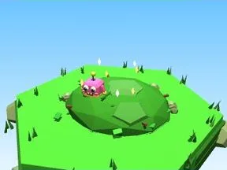 | [Tas à ratisser Jungle](Tas%20%C3%A0%20ratisser%20Jungle.md) | Élément de biome · 8 × 4 × 8 |
| 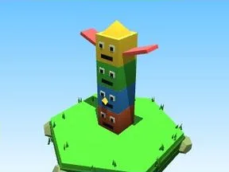 | [Totem (Jungle)](Totem%20%28Jungle%29.md) | Modèle low-poly · 8 × 11 × 3 |
| 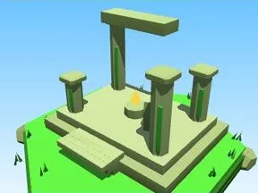 | [Ruine de temple (Jungle)](Ruine%20de%20temple%20%28Jungle%29.md) | Modèle low-poly · 16 × 12 × 14 |
