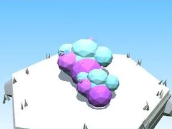
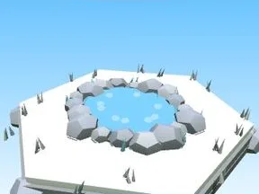
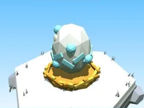
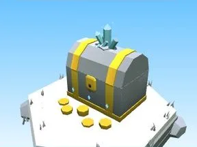
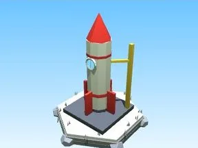

# Lune

Sous-catégorie de [Biomes](../Biomes.md) · **16 éléments**

| Aperçu | Élément | Infos |
| --- | --- | --- |
|  | [Arbre Lune](Arbre%20Lune.md) | Élément de biome · 6 × 12 × 6 |
|  | [Petit arbre Lune](Petit%20arbre%20Lune.md) | Élément de biome · 4 × 7 × 4 |
|  | [Buisson Lune](Buisson%20Lune.md) | Élément de biome · 7 × 3 × 5 |
|  | [Massif de fleurs Lune](Massif%20de%20fleurs%20Lune.md) | Élément de biome · 10 × 4 × 8 |
|  | [Rochers Lune](Rochers%20Lune.md) | Élément de biome · 7 × 4 × 6 |
|  | [Gros rocher Lune](Gros%20rocher%20Lune.md) | Élément de biome · 10 × 6 × 9 |
|  | [Cristaux Lune](Cristaux%20Lune.md) | Élément de biome · 6 × 7 × 6 |
|  | [Bloc de terrain Lune](Bloc%20de%20terrain%20Lune.md) | Élément de biome · 13 × 4 × 12 |
|  | [Étang Lune](%C3%89tang%20Lune.md) | Élément de biome · 12 × 2 × 11 |
|  | [Œuf Lune](%C5%92uf%20Lune.md) | Élément de biome · 5 × 4 × 4 |
|  | [Coffre Lune](Coffre%20Lune.md) | Élément de biome · 5 × 6 × 5 |
|  | [Clôture Lune](Cl%C3%B4ture%20Lune.md) | Élément de biome · 20 × 6 × 2 |
|  | [Portail de zone Lune](Portail%20de%20zone%20Lune.md) | Élément de biome · 18 × 14 × 9 |
|  | [Tas à ratisser Lune](Tas%20%C3%A0%20ratisser%20Lune.md) | Élément de biome · 8 × 4 × 8 |
|  | [Cratère (Lune)](Crat%C3%A8re%20%28Lune%29.md) | Modèle low-poly · 16 × 5 × 14 |
|  | [Fusée (Lune)](Fus%C3%A9e%20%28Lune%29.md) | Modèle low-poly · 9 × 18 × 9 |
