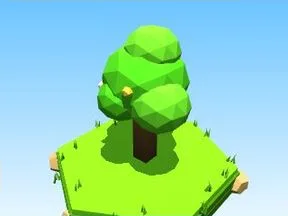
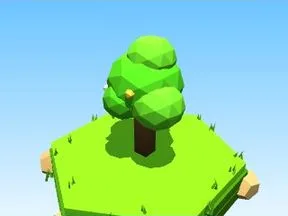
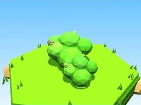
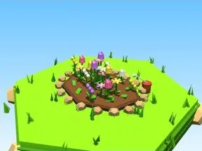
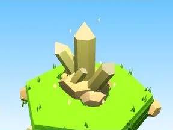
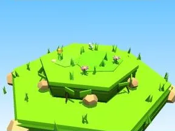
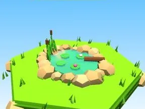
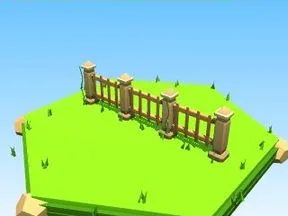
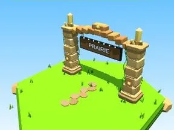
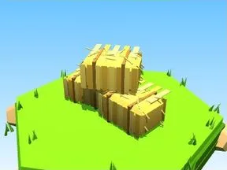

# Prairie

Sous-catégorie de [Biomes](../Biomes.md) · **16 éléments**

| Aperçu | Élément | Infos |
| --- | --- | --- |
|  | [Arbre Prairie](Arbre%20Prairie.md) | Élément de biome · 9 × 11 × 7 |
|  | [Petit arbre Prairie](Petit%20arbre%20Prairie.md) | Élément de biome · 5 × 7 × 4 |
|  | [Buisson Prairie](Buisson%20Prairie.md) | Élément de biome · 7 × 3 × 5 |
|  | [Massif de fleurs Prairie](Massif%20de%20fleurs%20Prairie.md) | Élément de biome · 10 × 4 × 8 |
|  | [Rochers Prairie](Rochers%20Prairie.md) | Élément de biome · 7 × 4 × 6 |
|  | [Gros rocher Prairie](Gros%20rocher%20Prairie.md) | Élément de biome · 10 × 8 × 9 |
|  | [Cristaux Prairie](Cristaux%20Prairie.md) | Élément de biome · 6 × 7 × 6 |
|  | [Bloc de terrain Prairie](Bloc%20de%20terrain%20Prairie.md) | Élément de biome · 13 × 4 × 12 |
|  | [Étang Prairie](%C3%89tang%20Prairie.md) | Élément de biome · 12 × 5 × 11 |
|  | [Œuf Prairie](%C5%92uf%20Prairie.md) | Élément de biome · 5 × 4 × 4 |
|  | [Coffre Prairie](Coffre%20Prairie.md) | Élément de biome · 5 × 6 × 5 |
|  | [Clôture Prairie](Cl%C3%B4ture%20Prairie.md) | Élément de biome · 20 × 6 × 2 |
|  | [Portail de zone Prairie](Portail%20de%20zone%20Prairie.md) | Élément de biome · 18 × 14 × 9 |
|  | [Tas à ratisser Prairie](Tas%20%C3%A0%20ratisser%20Prairie.md) | Élément de biome · 8 × 4 × 8 |
|  | [Ruche (Prairie)](Ruche%20%28Prairie%29.md) | Modèle low-poly · 8 × 10 × 5 |
|  | [Bottes de foin (Prairie)](Bottes%20de%20foin%20%28Prairie%29.md) | Modèle low-poly · 7 × 4 × 3 |
