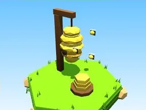

# Ruche (Prairie)

Décor spécial du biome Prairie.

- **Catégorie** : [Biomes](../Biomes.md)
- **Sous-catégorie** : [Prairie](Prairie.md)
- **Type** : Modèle low-poly
- **Taille** : 8 × 10 × 5 studs
