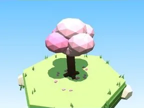

# Petit arbre Sakura

Version plus petite de l’arbre.

- **Catégorie** : [Biomes](../Biomes.md)
- **Sous-catégorie** : [Sakura](Sakura.md)
- **Type** : Élément de biome
- **Taille** : 5 × 6 × 5 studs
