# Sakura

Sous-catégorie de [Biomes](../Biomes.md) · **16 éléments**

| Aperçu | Élément | Infos |
| --- | --- | --- |
| 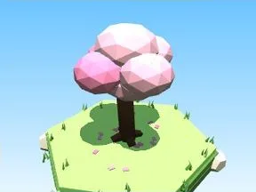 | [Arbre Sakura](Arbre%20Sakura.md) | Élément de biome · 9 × 11 × 9 |
|  | [Petit arbre Sakura](Petit%20arbre%20Sakura.md) | Élément de biome · 5 × 6 × 5 |
| 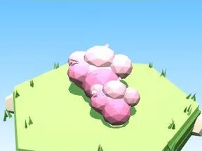 | [Buisson Sakura](Buisson%20Sakura.md) | Élément de biome · 7 × 3 × 5 |
| 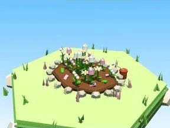 | [Massif de fleurs Sakura](Massif%20de%20fleurs%20Sakura.md) | Élément de biome · 10 × 4 × 8 |
| 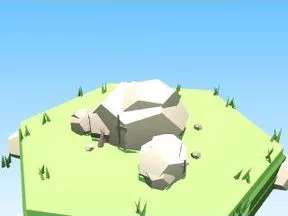 | [Rochers Sakura](Rochers%20Sakura.md) | Élément de biome · 7 × 4 × 6 |
| 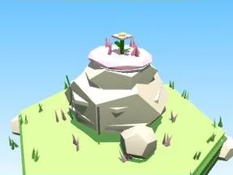 | [Gros rocher Sakura](Gros%20rocher%20Sakura.md) | Élément de biome · 10 × 8 × 9 |
| 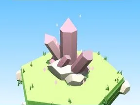 | [Cristaux Sakura](Cristaux%20Sakura.md) | Élément de biome · 6 × 7 × 6 |
|  | [Bloc de terrain Sakura](Bloc%20de%20terrain%20Sakura.md) | Élément de biome · 13 × 4 × 12 |
| 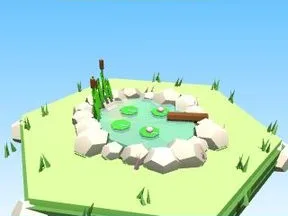 | [Étang Sakura](%C3%89tang%20Sakura.md) | Élément de biome · 12 × 5 × 11 |
| 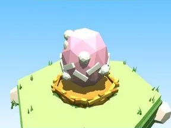 | [Œuf Sakura](%C5%92uf%20Sakura.md) | Élément de biome · 5 × 4 × 4 |
| 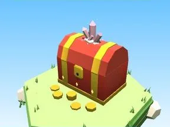 | [Coffre Sakura](Coffre%20Sakura.md) | Élément de biome · 5 × 6 × 5 |
| 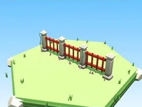 | [Clôture Sakura](Cl%C3%B4ture%20Sakura.md) | Élément de biome · 20 × 6 × 2 |
| 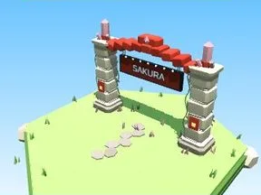 | [Portail de zone Sakura](Portail%20de%20zone%20Sakura.md) | Élément de biome · 18 × 14 × 9 |
| 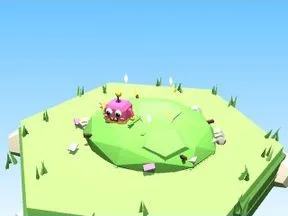 | [Tas à ratisser Sakura](Tas%20%C3%A0%20ratisser%20Sakura.md) | Élément de biome · 8 × 4 × 8 |
| 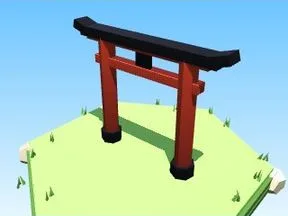 | [Torii (Sakura)](Torii%20%28Sakura%29.md) | Modèle low-poly · 16 × 12 × 2 |
|  | [Lanterne de pierre (Sakura)](Lanterne%20de%20pierre%20%28Sakura%29.md) | Modèle low-poly · 4 × 8 × 4 |
