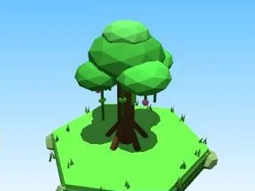
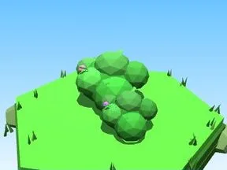
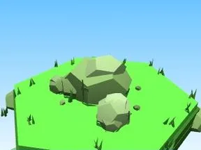
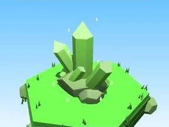
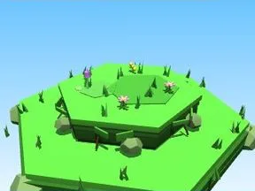
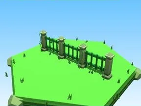
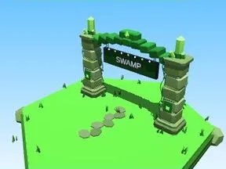
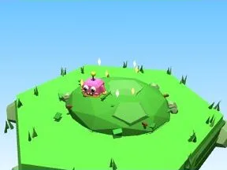
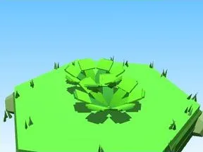

# Swamp

Sous-catégorie de [Biomes](../Biomes.md) · **16 éléments**

| Aperçu | Élément | Infos |
| --- | --- | --- |
|  | [Arbre Swamp](Arbre%20Swamp.md) | Élément de biome · 10 × 13 × 10 |
|  | [Petit arbre Swamp](Petit%20arbre%20Swamp.md) | Élément de biome · 6 × 8 × 6 |
|  | [Buisson Swamp](Buisson%20Swamp.md) | Élément de biome · 7 × 3 × 5 |
|  | [Massif de fleurs Swamp](Massif%20de%20fleurs%20Swamp.md) | Élément de biome · 10 × 4 × 8 |
|  | [Rochers Swamp](Rochers%20Swamp.md) | Élément de biome · 7 × 4 × 6 |
|  | [Gros rocher Swamp](Gros%20rocher%20Swamp.md) | Élément de biome · 10 × 8 × 9 |
|  | [Cristaux Swamp](Cristaux%20Swamp.md) | Élément de biome · 6 × 7 × 6 |
|  | [Bloc de terrain Swamp](Bloc%20de%20terrain%20Swamp.md) | Élément de biome · 13 × 4 × 12 |
|  | [Étang Swamp](%C3%89tang%20Swamp.md) | Élément de biome · 12 × 5 × 11 |
|  | [Œuf Swamp](%C5%92uf%20Swamp.md) | Élément de biome · 5 × 4 × 4 |
|  | [Coffre Swamp](Coffre%20Swamp.md) | Élément de biome · 7 × 7 × 5 |
|  | [Clôture Swamp](Cl%C3%B4ture%20Swamp.md) | Élément de biome · 20 × 6 × 2 |
|  | [Portail de zone Swamp](Portail%20de%20zone%20Swamp.md) | Élément de biome · 18 × 14 × 9 |
|  | [Tas à ratisser Swamp](Tas%20%C3%A0%20ratisser%20Swamp.md) | Élément de biome · 8 × 4 × 8 |
|  | [Champignons (Swamp)](Champignons%20%28Swamp%29.md) | Modèle low-poly · 4 × 2 × 3 |
|  | [Fougères (Swamp)](Foug%C3%A8res%20%28Swamp%29.md) | Modèle low-poly · 7 × 1 × 6 |
