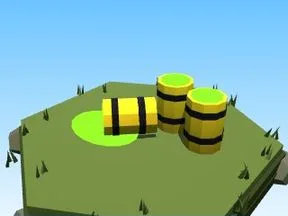

# Baril toxique (Toxique)

Décor spécial du biome Toxique.

- **Catégorie** : [Biomes](../Biomes.md)
- **Sous-catégorie** : [Toxique](Toxique.md)
- **Type** : Modèle low-poly
- **Taille** : 8 × 3 × 5 studs
