# Toxique

Sous-catégorie de [Biomes](../Biomes.md) · **16 éléments**

| Aperçu | Élément | Infos |
| --- | --- | --- |
| 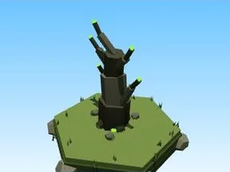 | [Arbre Toxique](Arbre%20Toxique.md) | Élément de biome · 7 × 10 × 5 |
| 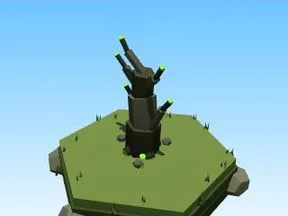 | [Petit arbre Toxique](Petit%20arbre%20Toxique.md) | Élément de biome · 4 × 6 × 3 |
| 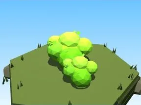 | [Buisson Toxique](Buisson%20Toxique.md) | Élément de biome · 7 × 3 × 5 |
|  | [Massif de fleurs Toxique](Massif%20de%20fleurs%20Toxique.md) | Élément de biome · 10 × 4 × 8 |
| 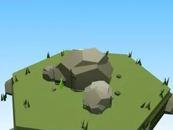 | [Rochers Toxique](Rochers%20Toxique.md) | Élément de biome · 7 × 4 × 6 |
|  | [Gros rocher Toxique](Gros%20rocher%20Toxique.md) | Élément de biome · 10 × 8 × 9 |
| 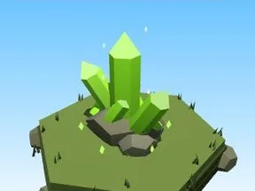 | [Cristaux Toxique](Cristaux%20Toxique.md) | Élément de biome · 6 × 7 × 6 |
|  | [Bloc de terrain Toxique](Bloc%20de%20terrain%20Toxique.md) | Élément de biome · 13 × 4 × 12 |
| 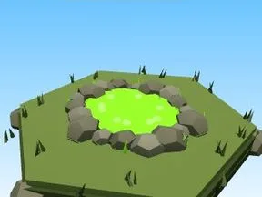 | [Étang Toxique](%C3%89tang%20Toxique.md) | Élément de biome · 12 × 2 × 11 |
| 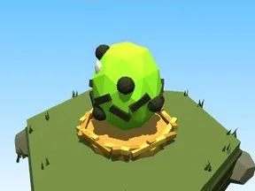 | [Œuf Toxique](%C5%92uf%20Toxique.md) | Élément de biome · 5 × 4 × 4 |
|  | [Coffre Toxique](Coffre%20Toxique.md) | Élément de biome · 5 × 6 × 5 |
| 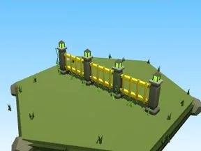 | [Clôture Toxique](Cl%C3%B4ture%20Toxique.md) | Élément de biome · 20 × 6 × 2 |
| 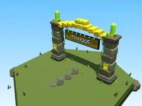 | [Portail de zone Toxique](Portail%20de%20zone%20Toxique.md) | Élément de biome · 18 × 14 × 9 |
| 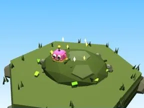 | [Tas à ratisser Toxique](Tas%20%C3%A0%20ratisser%20Toxique.md) | Élément de biome · 8 × 4 × 8 |
|  | [Baril toxique (Toxique)](Baril%20toxique%20%28Toxique%29.md) | Modèle low-poly · 8 × 3 × 5 |
| 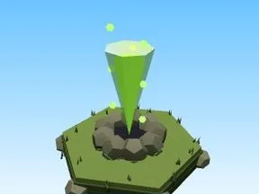 | [Geyser toxique (Toxique)](Geyser%20toxique%20%28Toxique%29.md) | Modèle low-poly · 8 × 12 × 8 |
