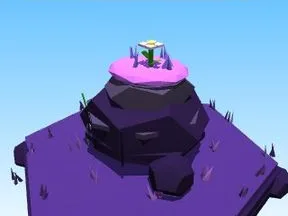

# Gros rocher Void

Gros bloc rocheux avec végétation.

- **Catégorie** : [Biomes](../Biomes.md)
- **Sous-catégorie** : [Void](Void.md)
- **Type** : Élément de biome
- **Taille** : 10 × 8 × 9 studs
