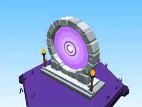

# Void

Sous-catégorie de [Biomes](../Biomes.md) · **16 éléments**

| Aperçu | Élément | Infos |
| --- | --- | --- |
|  | [Arbre Void](Arbre%20Void.md) | Élément de biome · 6 × 12 × 6 |
|  | [Petit arbre Void](Petit%20arbre%20Void.md) | Élément de biome · 4 × 7 × 4 |
|  | [Buisson Void](Buisson%20Void.md) | Élément de biome · 7 × 3 × 5 |
|  | [Massif de fleurs Void](Massif%20de%20fleurs%20Void.md) | Élément de biome · 10 × 4 × 8 |
|  | [Rochers Void](Rochers%20Void.md) | Élément de biome · 7 × 4 × 6 |
|  | [Gros rocher Void](Gros%20rocher%20Void.md) | Élément de biome · 10 × 8 × 9 |
|  | [Cristaux Void](Cristaux%20Void.md) | Élément de biome · 6 × 7 × 6 |
|  | [Bloc de terrain Void](Bloc%20de%20terrain%20Void.md) | Élément de biome · 13 × 4 × 12 |
|  | [Étang Void](%C3%89tang%20Void.md) | Élément de biome · 12 × 2 × 11 |
|  | [Œuf Void](%C5%92uf%20Void.md) | Élément de biome · 5 × 4 × 4 |
|  | [Coffre Void](Coffre%20Void.md) | Élément de biome · 7 × 10 × 5 |
|  | [Clôture Void](Cl%C3%B4ture%20Void.md) | Élément de biome · 20 × 6 × 2 |
|  | [Portail de zone Void](Portail%20de%20zone%20Void.md) | Élément de biome · 18 × 14 × 9 |
|  | [Tas à ratisser Void](Tas%20%C3%A0%20ratisser%20Void.md) | Élément de biome · 8 × 4 × 8 |
|  | [Îlot flottant (Void)](%C3%8Elot%20flottant%20%28Void%29.md) | Modèle low-poly · 9 × 12 × 9 |
|  | [Portail du Void (Void)](Portail%20du%20Void%20%28Void%29.md) | Modèle low-poly · 13 × 14 × 5 |
