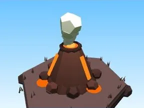

# Petit volcan (Volcano)

Décor spécial du biome Volcano.

- **Catégorie** : [Biomes](../Biomes.md)
- **Sous-catégorie** : [Volcano](Volcano.md)
- **Type** : Modèle low-poly
- **Taille** : 12 × 12 × 11 studs
