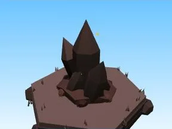

# Pics d’obsidienne (Volcano)

Décor spécial du biome Volcano.

- **Catégorie** : [Biomes](../Biomes.md)
- **Sous-catégorie** : [Volcano](Volcano.md)
- **Type** : Modèle low-poly
- **Taille** : 5 × 7 × 4 studs
