# Volcano

Sous-catégorie de [Biomes](../Biomes.md) · **16 éléments**

| Aperçu | Élément | Infos |
| --- | --- | --- |
| 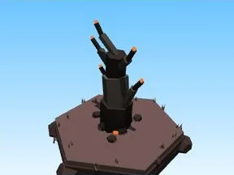 | [Arbre Volcano](Arbre%20Volcano.md) | Élément de biome · 7 × 10 × 5 |
| 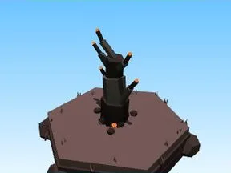 | [Petit arbre Volcano](Petit%20arbre%20Volcano.md) | Élément de biome · 4 × 6 × 3 |
| 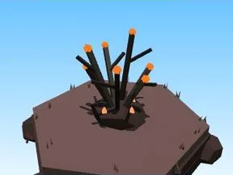 | [Buisson Volcano](Buisson%20Volcano.md) | Élément de biome · 4 × 4 × 4 |
| 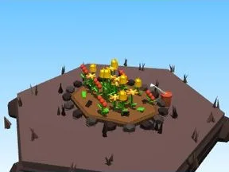 | [Massif de fleurs Volcano](Massif%20de%20fleurs%20Volcano.md) | Élément de biome · 10 × 4 × 8 |
| 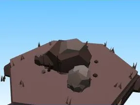 | [Rochers Volcano](Rochers%20Volcano.md) | Élément de biome · 7 × 4 × 6 |
|  | [Gros rocher Volcano](Gros%20rocher%20Volcano.md) | Élément de biome · 10 × 6 × 9 |
|  | [Cristaux Volcano](Cristaux%20Volcano.md) | Élément de biome · 6 × 7 × 6 |
| 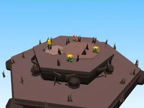 | [Bloc de terrain Volcano](Bloc%20de%20terrain%20Volcano.md) | Élément de biome · 13 × 4 × 12 |
| 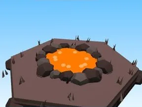 | [Étang Volcano](%C3%89tang%20Volcano.md) | Élément de biome · 12 × 2 × 11 |
| 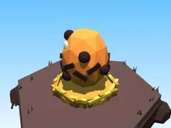 | [Œuf Volcano](%C5%92uf%20Volcano.md) | Élément de biome · 5 × 4 × 4 |
| 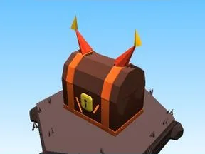 | [Coffre Volcano](Coffre%20Volcano.md) | Élément de biome · 8 × 9 × 5 |
| 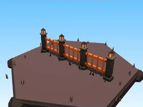 | [Clôture Volcano](Cl%C3%B4ture%20Volcano.md) | Élément de biome · 20 × 6 × 2 |
| 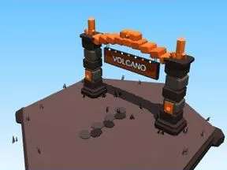 | [Portail de zone Volcano](Portail%20de%20zone%20Volcano.md) | Élément de biome · 18 × 14 × 9 |
| 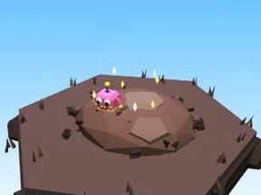 | [Tas à ratisser Volcano](Tas%20%C3%A0%20ratisser%20Volcano.md) | Élément de biome · 8 × 4 × 8 |
|  | [Petit volcan (Volcano)](Petit%20volcan%20%28Volcano%29.md) | Modèle low-poly · 12 × 12 × 11 |
|  | [Pics d’obsidienne (Volcano)](Pics%20d%E2%80%99obsidienne%20%28Volcano%29.md) | Modèle low-poly · 5 × 7 × 4 |
