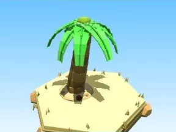

# Arbre Île au trésor

Arbre typique du biome.

- **Catégorie** : [Biomes](../Biomes.md)
- **Sous-catégorie** : [Île au trésor](%C3%8Ele%20au%20tr%C3%A9sor.md)
- **Type** : Élément de biome
- **Taille** : 10 × 9 × 9 studs
