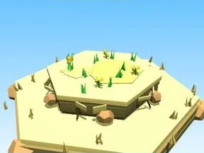

# Bloc de terrain Île au trésor

Morceau de sol hexagonal décoré, pour composer la map.

- **Catégorie** : [Biomes](../Biomes.md)
- **Sous-catégorie** : [Île au trésor](%C3%8Ele%20au%20tr%C3%A9sor.md)
- **Type** : Élément de biome
- **Taille** : 13 × 4 × 12 studs
