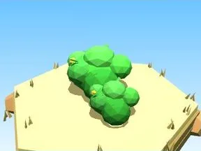
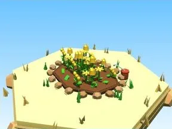
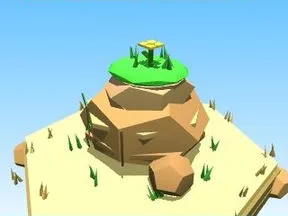
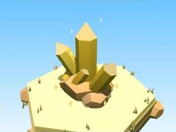
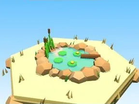
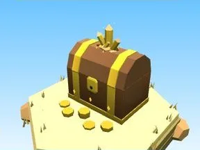
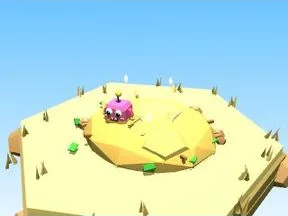
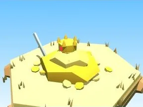
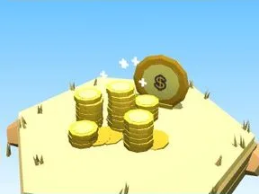

# Île au trésor

Sous-catégorie de [Biomes](../Biomes.md) · **16 éléments**

| Aperçu | Élément | Infos |
| --- | --- | --- |
|  | [Arbre Île au trésor](Arbre%20%C3%8Ele%20au%20tr%C3%A9sor.md) | Élément de biome · 10 × 9 × 9 |
|  | [Petit arbre Île au trésor](Petit%20arbre%20%C3%8Ele%20au%20tr%C3%A9sor.md) | Élément de biome · 6 × 6 × 6 |
|  | [Buisson Île au trésor](Buisson%20%C3%8Ele%20au%20tr%C3%A9sor.md) | Élément de biome · 7 × 3 × 5 |
|  | [Massif de fleurs Île au trésor](Massif%20de%20fleurs%20%C3%8Ele%20au%20tr%C3%A9sor.md) | Élément de biome · 10 × 4 × 8 |
|  | [Rochers Île au trésor](Rochers%20%C3%8Ele%20au%20tr%C3%A9sor.md) | Élément de biome · 7 × 4 × 6 |
|  | [Gros rocher Île au trésor](Gros%20rocher%20%C3%8Ele%20au%20tr%C3%A9sor.md) | Élément de biome · 10 × 8 × 9 |
|  | [Cristaux Île au trésor](Cristaux%20%C3%8Ele%20au%20tr%C3%A9sor.md) | Élément de biome · 6 × 7 × 6 |
|  | [Bloc de terrain Île au trésor](Bloc%20de%20terrain%20%C3%8Ele%20au%20tr%C3%A9sor.md) | Élément de biome · 13 × 4 × 12 |
|  | [Étang Île au trésor](%C3%89tang%20%C3%8Ele%20au%20tr%C3%A9sor.md) | Élément de biome · 12 × 5 × 11 |
|  | [Œuf Île au trésor](%C5%92uf%20%C3%8Ele%20au%20tr%C3%A9sor.md) | Élément de biome · 5 × 4 × 4 |
|  | [Coffre Île au trésor](Coffre%20%C3%8Ele%20au%20tr%C3%A9sor.md) | Élément de biome · 5 × 6 × 5 |
|  | [Clôture Île au trésor](Cl%C3%B4ture%20%C3%8Ele%20au%20tr%C3%A9sor.md) | Élément de biome · 20 × 6 × 2 |
|  | [Portail de zone Île au trésor](Portail%20de%20zone%20%C3%8Ele%20au%20tr%C3%A9sor.md) | Élément de biome · 18 × 14 × 9 |
|  | [Tas à ratisser Île au trésor](Tas%20%C3%A0%20ratisser%20%C3%8Ele%20au%20tr%C3%A9sor.md) | Élément de biome · 8 × 4 × 8 |
|  | [Tas de trésor (Île au trésor)](Tas%20de%20tr%C3%A9sor%20%28%C3%8Ele%20au%20tr%C3%A9sor%29.md) | Modèle low-poly · 8 × 4 × 7 |
|  | [Piles de pièces (Île au trésor)](Piles%20de%20pi%C3%A8ces%20%28%C3%8Ele%20au%20tr%C3%A9sor%29.md) | Modèle low-poly · 5 × 4 × 7 |
