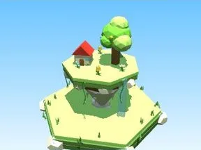

# Île flottante (Îles célestes)

Décor spécial du biome Îles célestes.

- **Catégorie** : [Biomes](../Biomes.md)
- **Sous-catégorie** : [Îles célestes](%C3%8Eles%20c%C3%A9lestes.md)
- **Type** : Modèle low-poly
- **Taille** : 11 × 15 × 11 studs
