# Îles célestes

Sous-catégorie de [Biomes](../Biomes.md) · **16 éléments**

| Aperçu | Élément | Infos |
| --- | --- | --- |
| 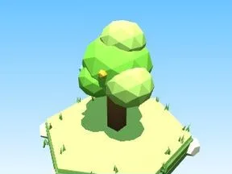 | [Arbre Îles célestes](Arbre%20%C3%8Eles%20c%C3%A9lestes.md) | Élément de biome · 9 × 11 × 7 |
| 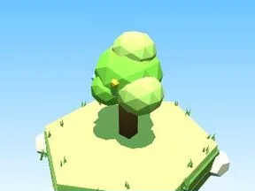 | [Petit arbre Îles célestes](Petit%20arbre%20%C3%8Eles%20c%C3%A9lestes.md) | Élément de biome · 5 × 7 × 4 |
| 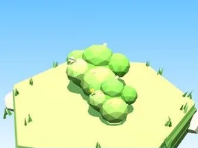 | [Buisson Îles célestes](Buisson%20%C3%8Eles%20c%C3%A9lestes.md) | Élément de biome · 7 × 3 × 5 |
| 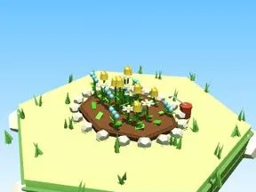 | [Massif de fleurs Îles célestes](Massif%20de%20fleurs%20%C3%8Eles%20c%C3%A9lestes.md) | Élément de biome · 10 × 4 × 8 |
| 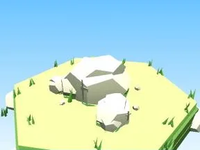 | [Rochers Îles célestes](Rochers%20%C3%8Eles%20c%C3%A9lestes.md) | Élément de biome · 7 × 4 × 6 |
| 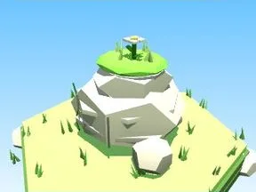 | [Gros rocher Îles célestes](Gros%20rocher%20%C3%8Eles%20c%C3%A9lestes.md) | Élément de biome · 10 × 8 × 9 |
| 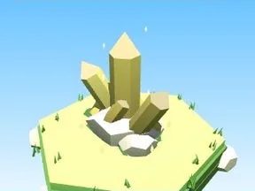 | [Cristaux Îles célestes](Cristaux%20%C3%8Eles%20c%C3%A9lestes.md) | Élément de biome · 6 × 7 × 6 |
| 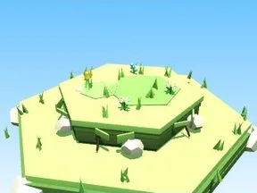 | [Bloc de terrain Îles célestes](Bloc%20de%20terrain%20%C3%8Eles%20c%C3%A9lestes.md) | Élément de biome · 13 × 4 × 12 |
| 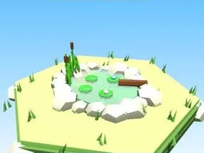 | [Étang Îles célestes](%C3%89tang%20%C3%8Eles%20c%C3%A9lestes.md) | Élément de biome · 12 × 5 × 11 |
| 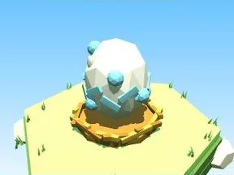 | [Œuf Îles célestes](%C5%92uf%20%C3%8Eles%20c%C3%A9lestes.md) | Élément de biome · 5 × 4 × 4 |
| 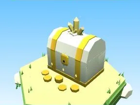 | [Coffre Îles célestes](Coffre%20%C3%8Eles%20c%C3%A9lestes.md) | Élément de biome · 5 × 6 × 5 |
| 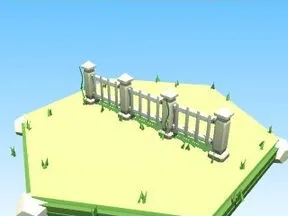 | [Clôture Îles célestes](Cl%C3%B4ture%20%C3%8Eles%20c%C3%A9lestes.md) | Élément de biome · 20 × 6 × 2 |
| 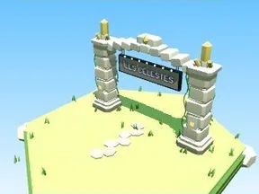 | [Portail de zone Îles célestes](Portail%20de%20zone%20%C3%8Eles%20c%C3%A9lestes.md) | Élément de biome · 18 × 14 × 9 |
| 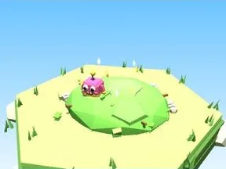 | [Tas à ratisser Îles célestes](Tas%20%C3%A0%20ratisser%20%C3%8Eles%20c%C3%A9lestes.md) | Élément de biome · 8 × 4 × 8 |
| 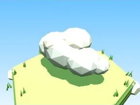 | [Nuage (Îles célestes)](Nuage%20%28%C3%8Eles%20c%C3%A9lestes%29.md) | Modèle low-poly · 12 × 6 × 7 |
|  | [Île flottante (Îles célestes)](%C3%8Ele%20flottante%20%28%C3%8Eles%20c%C3%A9lestes%29.md) | Modèle low-poly · 11 × 15 × 11 |
