# Brainrots

**48 éléments**

| Aperçu | Élément | Infos |
| --- | --- | --- |
| 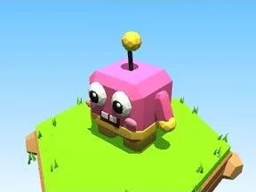 | [Cubo Rosa](Cubo%20Rosa.md) | Brainrot · 6 × 7 × 4 |
| 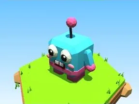 | [Cubo Blu](Cubo%20Blu.md) | Brainrot · 6 × 7 × 4 |
|  | [Cubo Verde](Cubo%20Verde.md) | Brainrot · 6 × 7 × 4 |
| 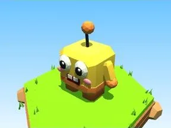 | [Cubo Dorato](Cubo%20Dorato.md) | Brainrot · 6 × 7 × 4 |
| 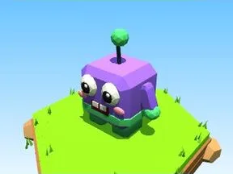 | [Cubo Viola](Cubo%20Viola.md) | Brainrot · 6 × 7 × 4 |
| 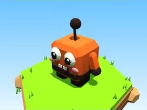 | [Cubo Lava](Cubo%20Lava.md) | Brainrot · 6 × 7 × 4 |
|  | [Cubo Ghiaccio](Cubo%20Ghiaccio.md) | Brainrot · 6 × 7 × 4 |
| 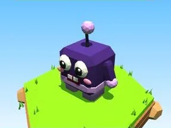 | [Cubo Cosmo](Cubo%20Cosmo.md) | Brainrot · 6 × 7 × 4 |
| 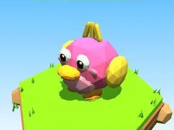 | [Quackini Rosa](Quackini%20Rosa.md) | Brainrot · 6 × 5 × 5 |
| 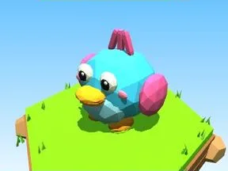 | [Quackini Blu](Quackini%20Blu.md) | Brainrot · 6 × 5 × 5 |
| 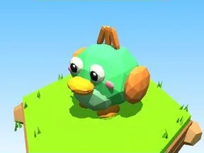 | [Quackini Verde](Quackini%20Verde.md) | Brainrot · 6 × 5 × 5 |
| 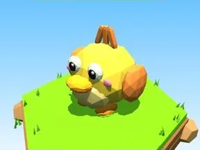 | [Quackini Dorato](Quackini%20Dorato.md) | Brainrot · 6 × 5 × 5 |
| 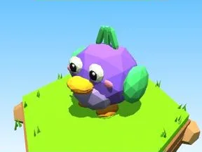 | [Quackini Viola](Quackini%20Viola.md) | Brainrot · 6 × 5 × 5 |
| 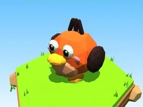 | [Quackini Lava](Quackini%20Lava.md) | Brainrot · 6 × 5 × 5 |
| 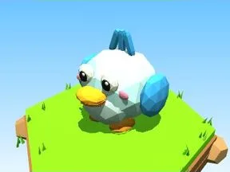 | [Quackini Ghiaccio](Quackini%20Ghiaccio.md) | Brainrot · 6 × 5 × 5 |
| 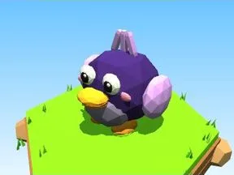 | [Quackini Cosmo](Quackini%20Cosmo.md) | Brainrot · 6 × 5 × 5 |
| 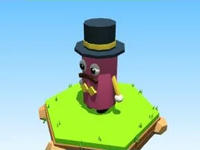 | [Sir Tubo Rosa](Sir%20Tubo%20Rosa.md) | Brainrot · 5 × 8 × 4 |
| 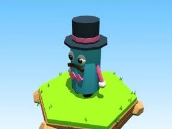 | [Sir Tubo Blu](Sir%20Tubo%20Blu.md) | Brainrot · 5 × 8 × 4 |
| 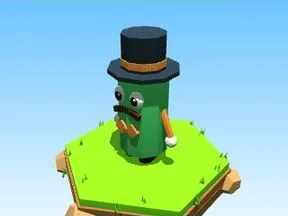 | [Sir Tubo Verde](Sir%20Tubo%20Verde.md) | Brainrot · 5 × 8 × 4 |
| 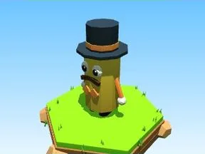 | [Sir Tubo Dorato](Sir%20Tubo%20Dorato.md) | Brainrot · 5 × 8 × 4 |
| 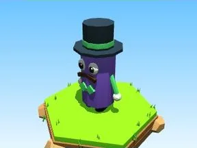 | [Sir Tubo Viola](Sir%20Tubo%20Viola.md) | Brainrot · 5 × 8 × 4 |
| 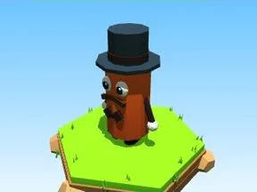 | [Sir Tubo Lava](Sir%20Tubo%20Lava.md) | Brainrot · 5 × 8 × 4 |
|  | [Sir Tubo Ghiaccio](Sir%20Tubo%20Ghiaccio.md) | Brainrot · 5 × 8 × 4 |
| 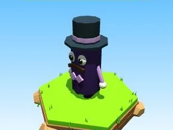 | [Sir Tubo Cosmo](Sir%20Tubo%20Cosmo.md) | Brainrot · 5 × 8 × 4 |
| 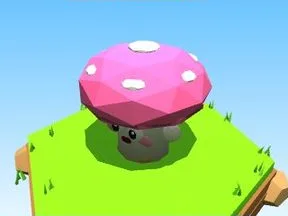 | [Fungalo Rosa](Fungalo%20Rosa.md) | Brainrot · 6 × 5 × 6 |
| 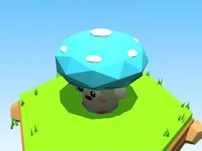 | [Fungalo Blu](Fungalo%20Blu.md) | Brainrot · 6 × 5 × 6 |
| 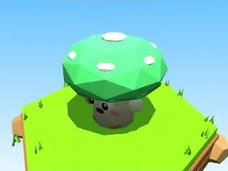 | [Fungalo Verde](Fungalo%20Verde.md) | Brainrot · 6 × 5 × 6 |
| 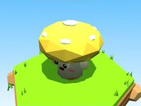 | [Fungalo Dorato](Fungalo%20Dorato.md) | Brainrot · 6 × 5 × 6 |
| 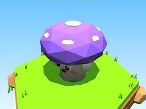 | [Fungalo Viola](Fungalo%20Viola.md) | Brainrot · 6 × 5 × 6 |
| 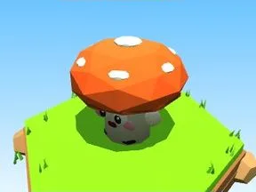 | [Fungalo Lava](Fungalo%20Lava.md) | Brainrot · 6 × 5 × 6 |
| 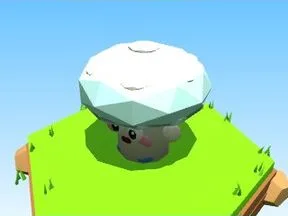 | [Fungalo Ghiaccio](Fungalo%20Ghiaccio.md) | Brainrot · 6 × 5 × 6 |
| 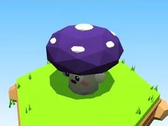 | [Fungalo Cosmo](Fungalo%20Cosmo.md) | Brainrot · 6 × 5 × 6 |
| 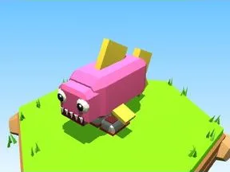 | [Sharkolino Rosa](Sharkolino%20Rosa.md) | Brainrot · 4 × 6 × 8 |
|  | [Sharkolino Blu](Sharkolino%20Blu.md) | Brainrot · 4 × 6 × 8 |
| 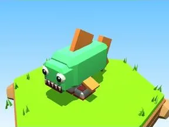 | [Sharkolino Verde](Sharkolino%20Verde.md) | Brainrot · 4 × 6 × 8 |
| 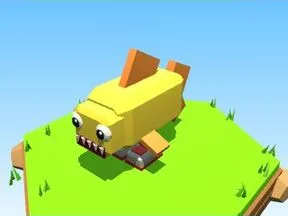 | [Sharkolino Dorato](Sharkolino%20Dorato.md) | Brainrot · 4 × 6 × 8 |
| 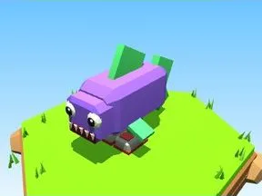 | [Sharkolino Viola](Sharkolino%20Viola.md) | Brainrot · 4 × 6 × 8 |
| 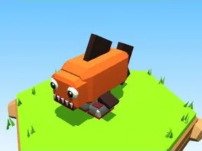 | [Sharkolino Lava](Sharkolino%20Lava.md) | Brainrot · 4 × 6 × 8 |
| 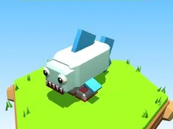 | [Sharkolino Ghiaccio](Sharkolino%20Ghiaccio.md) | Brainrot · 4 × 6 × 8 |
| 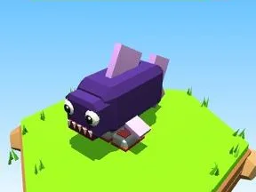 | [Sharkolino Cosmo](Sharkolino%20Cosmo.md) | Brainrot · 4 × 6 × 8 |
| 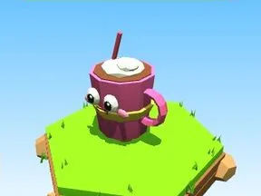 | [Cappuccio Rosa](Cappuccio%20Rosa.md) | Brainrot · 5 × 6 × 4 |
|  | [Cappuccio Blu](Cappuccio%20Blu.md) | Brainrot · 5 × 6 × 4 |
|  | [Cappuccio Verde](Cappuccio%20Verde.md) | Brainrot · 5 × 6 × 4 |
| 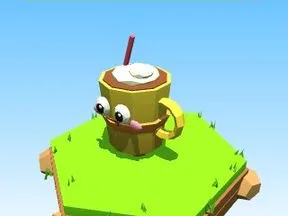 | [Cappuccio Dorato](Cappuccio%20Dorato.md) | Brainrot · 5 × 6 × 4 |
| 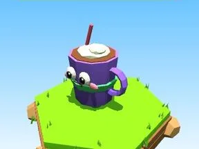 | [Cappuccio Viola](Cappuccio%20Viola.md) | Brainrot · 5 × 6 × 4 |
| 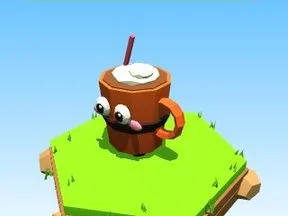 | [Cappuccio Lava](Cappuccio%20Lava.md) | Brainrot · 5 × 6 × 4 |
|  | [Cappuccio Ghiaccio](Cappuccio%20Ghiaccio.md) | Brainrot · 5 × 6 × 4 |
|  | [Cappuccio Cosmo](Cappuccio%20Cosmo.md) | Brainrot · 5 × 6 × 4 |

Retour : [Rake Vault](../Rake%20Vault.md)
