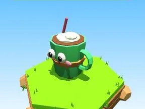

# Cappuccio Verde

Brainrot Cappuccio en version Verde.

- **Catégorie** : [Brainrots](Brainrots.md)
- **Type** : Brainrot
- **Taille** : 5 × 6 × 4 studs

## Variantes

- [Cappuccio Rosa](Cappuccio%20Rosa.md)
- [Cappuccio Blu](Cappuccio%20Blu.md)
- [Cappuccio Dorato](Cappuccio%20Dorato.md)
- [Cappuccio Viola](Cappuccio%20Viola.md)
- [Cappuccio Lava](Cappuccio%20Lava.md)
- [Cappuccio Ghiaccio](Cappuccio%20Ghiaccio.md)
- [Cappuccio Cosmo](Cappuccio%20Cosmo.md)
