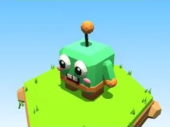

# Cubo Verde

Brainrot Cubo en version Verde.

- **Catégorie** : [Brainrots](Brainrots.md)
- **Type** : Brainrot
- **Taille** : 6 × 7 × 4 studs

## Variantes

- [Cubo Rosa](Cubo%20Rosa.md)
- [Cubo Blu](Cubo%20Blu.md)
- [Cubo Dorato](Cubo%20Dorato.md)
- [Cubo Viola](Cubo%20Viola.md)
- [Cubo Lava](Cubo%20Lava.md)
- [Cubo Ghiaccio](Cubo%20Ghiaccio.md)
- [Cubo Cosmo](Cubo%20Cosmo.md)
