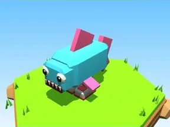

# Sharkolino Blu

Brainrot Sharkolino en version Blu.

- **Catégorie** : [Brainrots](Brainrots.md)
- **Type** : Brainrot
- **Taille** : 4 × 6 × 8 studs

## Variantes

- [Sharkolino Rosa](Sharkolino%20Rosa.md)
- [Sharkolino Verde](Sharkolino%20Verde.md)
- [Sharkolino Dorato](Sharkolino%20Dorato.md)
- [Sharkolino Viola](Sharkolino%20Viola.md)
- [Sharkolino Lava](Sharkolino%20Lava.md)
- [Sharkolino Ghiaccio](Sharkolino%20Ghiaccio.md)
- [Sharkolino Cosmo](Sharkolino%20Cosmo.md)
