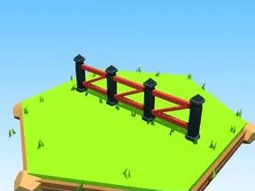

# Clôture enclos rouge

Segment de clôture d’enclos.

- **Catégorie** : [Enclos](Enclos.md)
- **Type** : Modèle low-poly
- **Taille** : 20 × 6 × 2 studs

## Variantes

- [Clôture enclos bois](Cl%C3%B4ture%20enclos%20bois.md)
- [Clôture enclos blanc](Cl%C3%B4ture%20enclos%20blanc.md)
- [Clôture enclos bleu](Cl%C3%B4ture%20enclos%20bleu.md)
- [Clôture enclos rose](Cl%C3%B4ture%20enclos%20rose.md)
- [Clôture enclos or](Cl%C3%B4ture%20enclos%20or.md)
