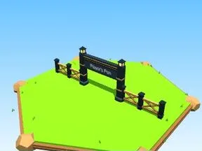
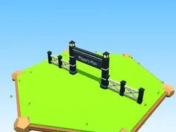
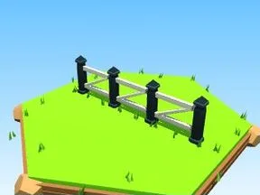
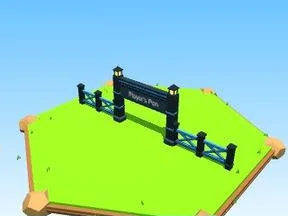
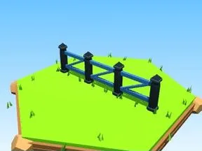
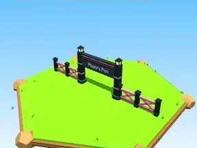
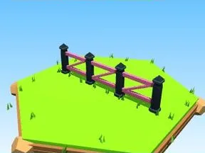
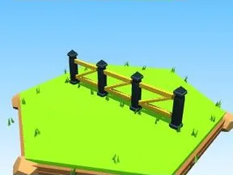
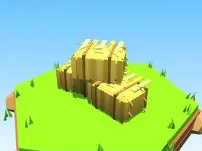
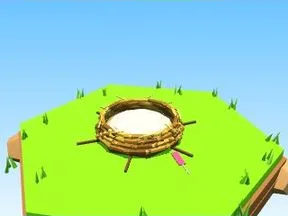

# Enclos

**18 éléments**

| Aperçu | Élément | Infos |
| --- | --- | --- |
|  | [Portail Player’s Pen bois](Portail%20Player%E2%80%99s%20Pen%20bois.md) | Modèle low-poly · 45 × 14 × 3 |
|  | [Clôture enclos bois](Cl%C3%B4ture%20enclos%20bois.md) | Modèle low-poly · 20 × 6 × 2 |
|  | [Portail Player’s Pen blanc](Portail%20Player%E2%80%99s%20Pen%20blanc.md) | Modèle low-poly · 45 × 14 × 3 |
|  | [Clôture enclos blanc](Cl%C3%B4ture%20enclos%20blanc.md) | Modèle low-poly · 20 × 6 × 2 |
|  | [Portail Player’s Pen rouge](Portail%20Player%E2%80%99s%20Pen%20rouge.md) | Modèle low-poly · 45 × 14 × 3 |
|  | [Clôture enclos rouge](Cl%C3%B4ture%20enclos%20rouge.md) | Modèle low-poly · 20 × 6 × 2 |
|  | [Portail Player’s Pen bleu](Portail%20Player%E2%80%99s%20Pen%20bleu.md) | Modèle low-poly · 45 × 14 × 3 |
|  | [Clôture enclos bleu](Cl%C3%B4ture%20enclos%20bleu.md) | Modèle low-poly · 20 × 6 × 2 |
|  | [Portail Player’s Pen rose](Portail%20Player%E2%80%99s%20Pen%20rose.md) | Modèle low-poly · 45 × 14 × 3 |
|  | [Clôture enclos rose](Cl%C3%B4ture%20enclos%20rose.md) | Modèle low-poly · 20 × 6 × 2 |
|  | [Portail Player’s Pen or](Portail%20Player%E2%80%99s%20Pen%20or.md) | Modèle low-poly · 45 × 14 × 3 |
|  | [Clôture enclos or](Cl%C3%B4ture%20enclos%20or.md) | Modèle low-poly · 20 × 6 × 2 |
|  | [Pad COLLECT](Pad%20COLLECT.md) | Modèle low-poly · 8 × 4 × 8 |
|  | [Bottes de foin](Bottes%20de%20foin.md) | Modèle low-poly · 7 × 4 × 3 |
|  | [Abreuvoir](Abreuvoir%20%C2%B7%20Enclos.md) | Modèle low-poly · 4 × 2 × 8 |
|  | [Gamelle](Gamelle.md) | Modèle low-poly · 5 × 1 × 3 |
|  | [Nid](Nid.md) | Modèle low-poly · 7 × 1 × 5 |
|  | [Panneau d’enclos](Panneau%20d%E2%80%99enclos.md) | Modèle low-poly · 8 × 6 × 2 |

Retour : [Rake Vault](../Rake%20Vault.md)
